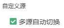

# LX Music Enhanced

## Quick source entry

Android settings support camera QR scanning, QR recognition from an image and pasting links. Confirm whether the address is a single script or a subscription catalog before adding it; enabling an imported script runs it in the app. Only import trusted content.

Enable the temporary HTTP page to configure this device from another phone or computer on the same reachable Wi-Fi network. Scan the displayed QR to open the browser page directly, or enter the displayed address and six-digit pairing code manually. The QR contains a temporary credential: do not share it. The service closes after ten minutes, when the app enters the background, or when leaving settings. HTTP is unencrypted; use a trusted network. No camera is required for image recognition, pasted links or browser configuration.

A derivative of [lyswhut/lx-music](https://github.com/lyswhut/lx-music) and [lx-music-mobile](https://github.com/lyswhut/lx-music-mobile), licensed under Apache-2.0. Original copyright notices are retained. See NOTICE for modifications.

## APK downloads

[GitHub Releases](https://github.com/shellsec/lx-music-mobile-auto-source/releases)

Download **`v1.9.2`** for your device below. These APKs contain no bundled music sources. Choose arm64-v8a for most Android phones, or universal if unsure.

| Architecture | Original download | Accelerated download | QR code |
| --- | --- | --- | --- |
| arm64-v8a | [GitHub](https://github.com/shellsec/lx-music-mobile-auto-source/releases/download/v1.9.2/lx-music-mobile-v1.9.2-arm64-v8a.apk) | [Accelerated download](https://gh-proxy.com/https://github.com/shellsec/lx-music-mobile-auto-source/releases/download/v1.9.2/lx-music-mobile-v1.9.2-arm64-v8a.apk) | [Generate QR code](https://quickchart.io/qr?size=640&margin=4&text=https%3A%2F%2Fgh-proxy.com%2Fhttps%3A%2F%2Fgithub.com%2Fshellsec%2Flx-music-mobile-auto-source%2Freleases%2Fdownload%2Fv1.9.2%2Flx-music-mobile-v1.9.2-arm64-v8a.apk) |
| armeabi-v7a | [GitHub](https://github.com/shellsec/lx-music-mobile-auto-source/releases/download/v1.9.2/lx-music-mobile-v1.9.2-armeabi-v7a.apk) | [Accelerated download](https://gh-proxy.com/https://github.com/shellsec/lx-music-mobile-auto-source/releases/download/v1.9.2/lx-music-mobile-v1.9.2-armeabi-v7a.apk) | [Generate QR code](https://quickchart.io/qr?size=640&margin=4&text=https%3A%2F%2Fgh-proxy.com%2Fhttps%3A%2F%2Fgithub.com%2Fshellsec%2Flx-music-mobile-auto-source%2Freleases%2Fdownload%2Fv1.9.2%2Flx-music-mobile-v1.9.2-armeabi-v7a.apk) |
| universal | [GitHub](https://github.com/shellsec/lx-music-mobile-auto-source/releases/download/v1.9.2/lx-music-mobile-v1.9.2-universal.apk) | [Accelerated download](https://gh-proxy.com/https://github.com/shellsec/lx-music-mobile-auto-source/releases/download/v1.9.2/lx-music-mobile-v1.9.2-universal.apk) | [Generate QR code](https://quickchart.io/qr?size=640&margin=4&text=https%3A%2F%2Fgh-proxy.com%2Fhttps%3A%2F%2Fgithub.com%2Fshellsec%2Flx-music-mobile-auto-source%2Freleases%2Fdownload%2Fv1.9.2%2Flx-music-mobile-v1.9.2-universal.apk) |
| x86_64 | [GitHub](https://github.com/shellsec/lx-music-mobile-auto-source/releases/download/v1.9.2/lx-music-mobile-v1.9.2-x86_64.apk) | [Accelerated download](https://gh-proxy.com/https://github.com/shellsec/lx-music-mobile-auto-source/releases/download/v1.9.2/lx-music-mobile-v1.9.2-x86_64.apk) | [Generate QR code](https://quickchart.io/qr?size=640&margin=4&text=https%3A%2F%2Fgh-proxy.com%2Fhttps%3A%2F%2Fgithub.com%2Fshellsec%2Flx-music-mobile-auto-source%2Freleases%2Fdownload%2Fv1.9.2%2Flx-music-mobile-v1.9.2-x86_64.apk) |
| x86 | [GitHub](https://github.com/shellsec/lx-music-mobile-auto-source/releases/download/v1.9.2/lx-music-mobile-v1.9.2-x86.apk) | [Accelerated download](https://gh-proxy.com/https://github.com/shellsec/lx-music-mobile-auto-source/releases/download/v1.9.2/lx-music-mobile-v1.9.2-x86.apk) | [Generate QR code](https://quickchart.io/qr?size=640&margin=4&text=https%3A%2F%2Fgh-proxy.com%2Fhttps%3A%2F%2Fgithub.com%2Fshellsec%2Flx-music-mobile-auto-source%2Freleases%2Fdownload%2Fv1.9.2%2Flx-music-mobile-v1.9.2-x86.apk) |

Acceleration is provided by a third-party [download service](https://gh-proxy.com/). For future versions, paste the corresponding APK's GitHub download URL into that page. No download proxy or source address is bundled in the app.

Each QR link opens a QR image generated by [QuickChart](https://quickchart.io/), containing that row's complete accelerated APK download URL.

## Import custom sources

A fresh installation contains no custom sources. Multi-source automatic switching is off, and the subscription URL is empty. In Settings, open custom source management and import your own local script or enter your own script URL, then select a source. Imported sources can be removed and reordered.

The following image illustrates source management. Its entries are user imports, not bundled or recommended sources. Layout and button labels can differ between client versions.

## Multi-source automatic switching

Enable multi-source automatic switching in Settings to try other imported sources after playback URL resolution fails. Each song starts with the first source in the user list; subsequent attempts follow that list's order. Reorder sources to change their priority. Selecting an individual source disables switching.

The checked state above is an example of manually enabling the feature. It is off on a fresh installation.

## Automatic subscription updates

Enter your own catalog URL once and select the save-and-update button in Settings. The address persists across restarts. Example: `https://example.com/sources.json`. Button labels may differ from the management illustration above.

- With one subscription source selected, failed playback URL resolution checks the saved catalog. Changed content reloads and retries that same source without enabling multi-source switching.
- In multi-source mode, all imported sources are tried first. If they all fail, the saved catalog is checked; changed content triggers one more pass in user list order.
- Failed or unchanged updates preserve local content and stop the recovery attempt. Automatic checks run at most once for recent failures of the same song and once per URL per minute.

Updates apply only after all scripts download. Existing source order and local imports are preserved; new subscription sources are appended. Startup does not download catalogs. You can also update manually at any time. Clear and save the URL to disable automatic updates while retaining imported sources. Unrelated locally imported scripts are not automatically updated by the subscription.

Catalogs contain an array of objects with unique `id`, `name`, and `url` fields, optionally wrapped in `sources`. Script URLs are supplied by the user. Relative paths resolve against the catalog URL.

## Build

With Node.js 18+, Android SDK and Java 17 installed, run `npm ci` and `npm run pack:android`. APKs appear in `android/app/build/outputs/apk/release/` and retain the filename pattern `lx-music-mobile-vVERSION-ARCH.apk`.

## Disclaimer

This software provides no music sources. Users are responsible for imported content and must comply with local laws and copyright requirements.
